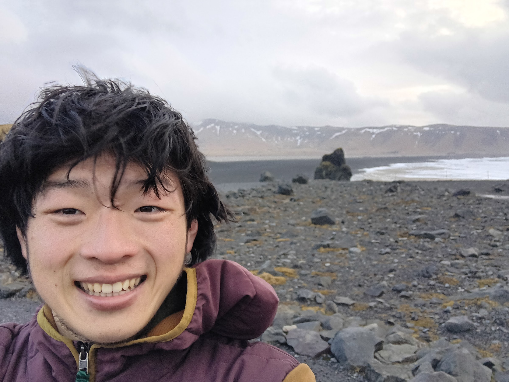

    

        
        
Dyrhólaey, Iceland Winter 2024

    

    

        <h2>Hello!</h2>
        
I'm a second year graduate student at UC Berkeley curious about representation theory, algebraic geometry, and mathematical physics, with particular interests in loop groups, affine Lie algebras, and the moduli of G-bundles on algebraic curves. I will obtain my master's degree in December 2026 and am currently looking for jobs in quantitative finance.

        
You can write me at songyuye at berkeley dot edu 

    

